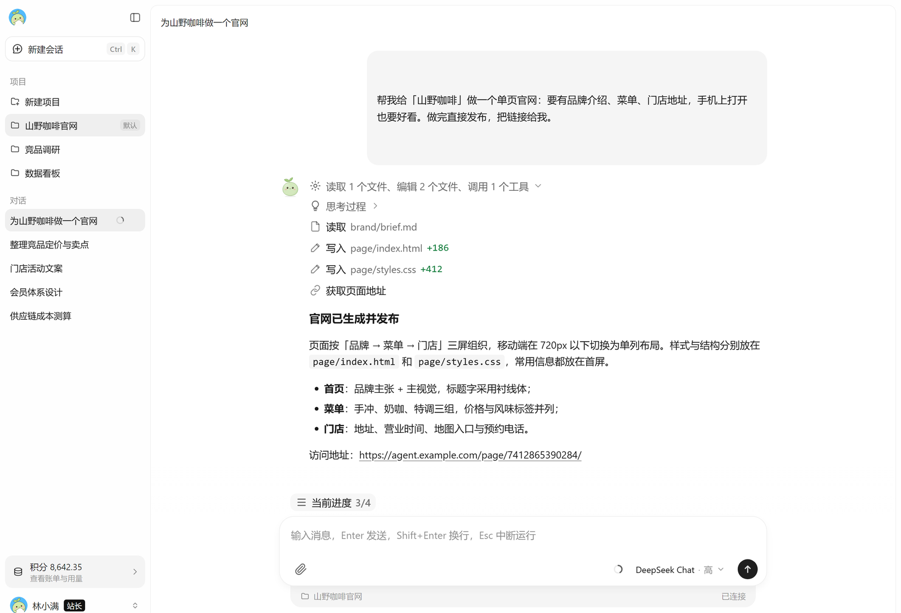
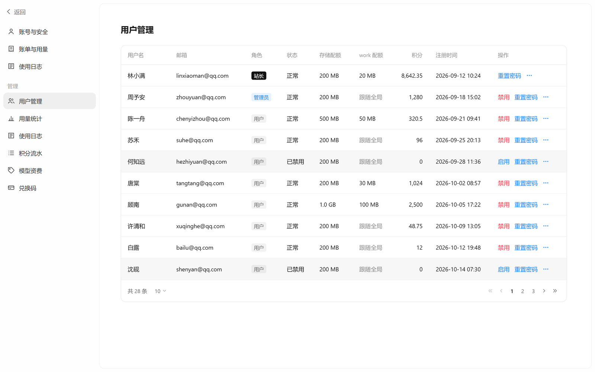
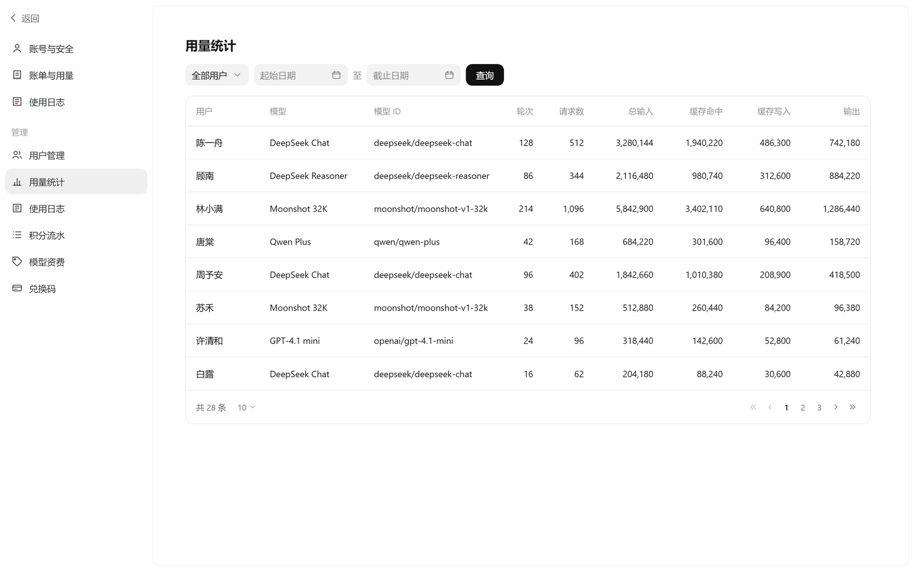
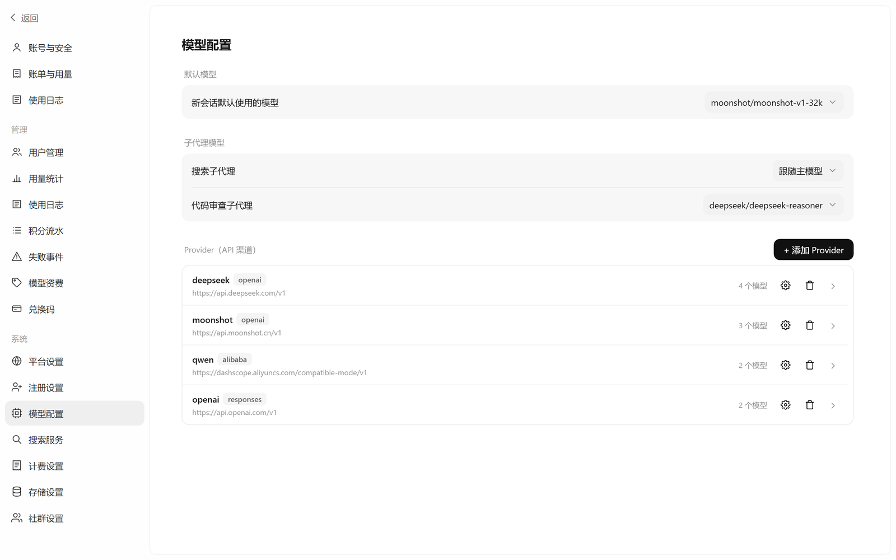
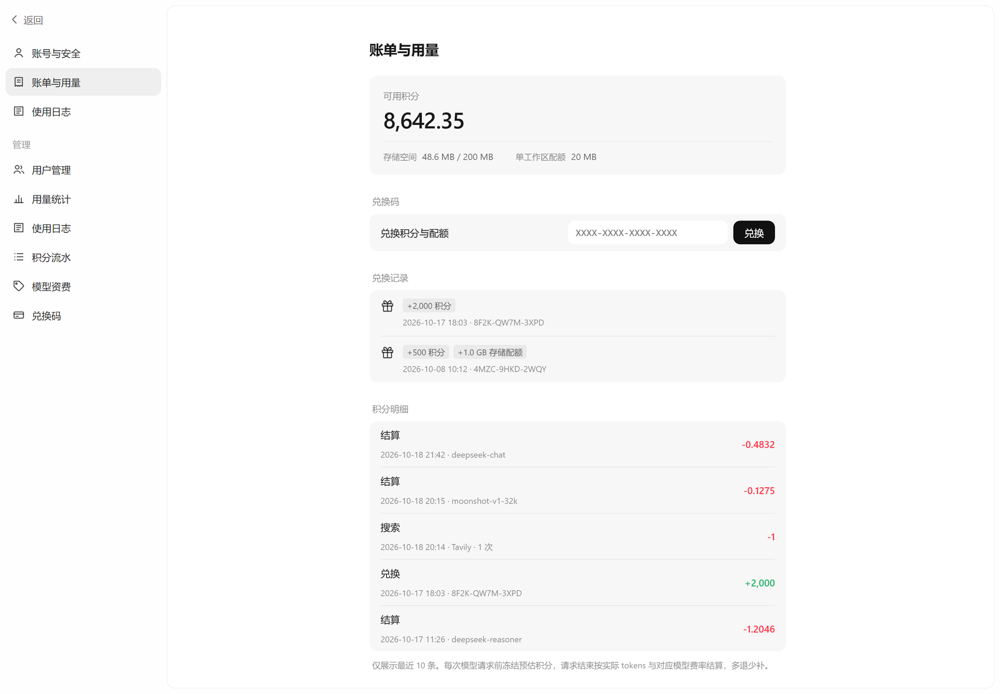

# SpringAgent

<div align="center">

**云端 Agent 平台**

把 Agent 能力接入统一的 Web 对话入口，在同一套控制台里管理用户、对话、项目、用量与成本。

<p align="center">
  <a href="#screenshots">项目截图</a> •
  <a href="#capabilities">核心能力</a> •
  <a href="#architecture">架构</a> •
  <a href="#quick-start">快速开始</a> •
  <a href="#deployment">部署运维</a> •
  <a href="#development">开发扩展</a> •
  <a href="#faq">常见问题</a>
</p>

<p align="center">
  
  
  
  
  
</p>

</div>

---

## 📝 项目说明

SpringAgent是面向更多行业用户的云端Agent平台， 将云端 Agent 能力接入统一的 Web 对话入口，在同一套控制台中管理用户、对话、知识库、用量与成本。

你可以用它为团队开通云端 Agent 能力，在对话中直接完成任务并交付真实产物，或搭建自己的行业 Agent 服务。支持发布网站、沉淀知识库、留存对话记录、按用量计费，并内置账号体系与对象存储等基础设施，开箱即用。

> [!IMPORTANT]
> - 使用者必须合法取得上游 API Key、账号、模型服务或接口权限，并遵守上游服务条款及适用法律法规。
> - 面向公众提供生成式人工智能服务时，使用者应遵守[《生成式人工智能服务管理暂行办法》](http://www.cac.gov.cn/2023-07/13/c_1690898327029107.htm)等监管要求，自行完成所在司法辖区要求的备案、许可、内容安全、实名、日志留存、税务和上游授权等合规义务。
> - 默认密码、JWT 密钥和内部令牌写在 `docker-compose.yml` 中且公开，公网部署前必须更换。

---

<a id="screenshots"></a>

## 项目截图

以下界面使用静态页面配合模拟数据渲染后截图，未启动真实服务；账号、对话、金额与站点均为虚构。点击图片可查看原图。

| 对话与工作过程 | 发布后的网站 |
| --- | --- |
| [](assets/screenshots/chat.zh-CN.png) | [](assets/screenshots/site-publish.zh-CN.png) |
| **用户管理** | **用量统计** |
| [](assets/screenshots/admin-users.zh-CN.png) | [](assets/screenshots/admin-usage.zh-CN.png) |
| **模型配置** | **账单与用量** |
| [](assets/screenshots/admin-model-config.zh-CN.png) | [](assets/screenshots/admin-points.zh-CN.png) |

---

<a id="capabilities"></a>

## 核心能力

| 方向 | 可以做什么 |
| --- | --- |
| 对话与任务 | WebSocket 流式输出，展示思考过程、工具调用与执行结果；支持中断、断线重连、接管会话和按段翻页的历史记录。 |
| 项目工作区 | 每个「项目」对应独立目录，会话共享项目文件；支持新建、切换、删除项目，默认每用户 5 个。 |
| 文件操作 | Agent 可读取、写入、编辑、搜索、查找、删除项目文件；写入采用哈希校验的乐观并发控制，路径限制在工作区内。 |
| 个人知识库 | 每个用户一份跨项目的 Markdown 知识库，写入需用户在对话中批准。 |
| 联网与读图 | 接入服务商联网搜索，按次计费；模型声明图片输入能力后可查看公网图片或本站上传的图片。 |
| 计划与子代理 | 计划清单实时推送到界面；内置 `searcher`（检索）与 `reviewer`（只读代码审查）两个子代理，可分别配置模型。 |
| 上下文管理 | 上下文占用达到模型窗口的 80% 时自动摘要压缩，保留最近 4 条消息；压缩过程与费用计入用量。 |
| 网站发布 | Agent 把静态站点写入项目的 `page/` 目录，即可通过 `/page/{pageId}/` 公开访问，支持 HTML/CSS/JS、图片、字体与常见媒体文件。 |
| 多用户与权限 | 站长 / 管理员 / 普通用户三级角色；注册开关、邮箱验证码、账号禁用、存储与项目配额、站长专属系统设置。 |
| 积分计费 | 按模型与 token 计费：请求前冻结预估积分，结束后按实际用量结算，多退少补；提供资费卡、兑换码、流水与逐次用量日志。 |
| 模型接入 | 管理模型渠道（`openai` / `alibaba` / `deepseek` / `responses`），配置模型能力、上下文窗口、思考挡位与默认模型。 |

### 角色与权限

| 能力 | 普通用户 | 管理员 | 站长 |
| --- | :---: | :---: | :---: |
| 对话、项目、上传、个人账单与使用日志 | ✓ | ✓ | ✓ |
| 用户管理、全量用量与积分流水 | — | ✓ | ✓ |
| 查看模型资费、查看兑换码 | — | ✓ | ✓ |
| 生成 / 作废兑换码、调整用户积分与角色 | — | — | ✓ |
| 模型配置、注册 / 存储 / 搜索 / 计费 / 平台 / 社群设置、失败事件 | — | — | ✓ |

站长是首个注册账号，不能在界面中转交；管理员只能操作普通用户，不能禁用站长或修改站长角色。

---

<a id="quick-start"></a>

## 快速开始

### 环境要求

- Linux，已安装并启动 Docker，当前用户具有 Docker 操作权限。
- Docker Compose 插件 **2.23.1 或以上**。
- 已安装 Bash 和 curl，服务器可以访问 GitHub Raw、GHCR 和 Docker Hub。
- 建议至少 2 vCPU / 4 GB 内存 / 20 GB 磁盘；工作文件与升级备份会额外占用磁盘。

检查 Docker 和 Compose：

```bash
docker version
docker compose version
```

### 首次部署

**1. 创建部署目录，下载配置。**

```bash
umask 077
mkdir -p ~/springagent && cd ~/springagent &&
curl -fL \
  https://raw.githubusercontent.com/Radiant303/SpringAgent/master/docker-compose.yml \
  -o docker-compose.yml
```

**2. 按需修改配置。**

YAML 已提供可运行的默认值，不修改也可以启动：

| 配置 | 默认值 |
| --- | --- |
| 网页端口 | `17900` |
| MySQL 应用用户名 | `springagent` |
| MySQL 应用密码 | `springagent-mysql` |
| MySQL root 密码 | `springagent-mysql` |
| RabbitMQ 用户名 | `springagent` |
| RabbitMQ 密码 | `springagent-rabbitmq` |
| 应用镜像 | `ghcr.io/radiant303/springagent:latest` |

密码、JWT 密钥、内部令牌和网页端口均在 `x-settings` 中修改一次，通过 YAML 锚点自动复用。JWT 密钥和内部令牌需各自至少 32 字节。

> 默认密码和密钥公开。公网部署建议在首次启动前更换为独立随机值。

**3. 拉取镜像并启动。**

```bash
docker compose pull &&
docker compose up -d --wait --wait-timeout 600
```

启动顺序为 MySQL / Redis / RabbitMQ 健康 → 应用容器执行 `alembic upgrade head` 并启动网关与引擎 → 健康检查通过后启动 Nginx。迁移失败时应用容器退出，不会带着旧库结构启动。

**4. 查看状态并访问网页。**

```bash
docker compose ps -a
docker compose logs --tail=100 springagent
```

浏览器访问 `http://服务器IP:17900`；本机部署访问 `http://localhost:17900`。远程访问时需允许网页端口通过服务器防火墙或云安全组。

首次注册的账号成为站长。登录后台后，配置模型服务商、API Key、模型及默认模型，再按需配置积分资费、邮箱和搜索服务。公网正式使用建议在前面再加一层 HTTPS 反向代理。

### 升级部署

以下步骤适用于已经使用当前 `springagent` 单镜像方案部署的用户。保持原部署目录、项目名、账号、密码、密钥和持久卷不变。

**1. 进入原部署目录，下载升级脚本。**

```bash
cd ~/springagent &&
mkdir -p deploy &&
curl -fL \
  https://raw.githubusercontent.com/Radiant303/SpringAgent/master/deploy/upgrade.sh \
  -o deploy/upgrade.sh
```

**2. 执行升级。**

```bash
cp -p docker-compose.yml docker-compose.yml.bak &&
bash deploy/upgrade.sh
```

升级脚本按以下顺序执行：

1. 拉取镜像，检查项目名、挂载方式及 RabbitMQ 节点兼容性；拉取或前置检查失败时，不停止旧应用。
2. 停止 `springagent` 和 Nginx，等待基础服务就绪。
3. 备份 MySQL、完整工作文件卷和缓存密钥。
4. 重建 `springagent`，由容器启动命令执行一次数据库迁移。
5. 应用健康后启动 Nginx。

备份保存在部署目录下的 `backups/时间戳目录/`：

- `mysql.sql`：数据库备份。
- `app-data.tar.gz`：完整共享文件目录，包含工作文件和密钥。
- `secrets.tar.gz`：缓存密钥的单独备份。

可指定备份目录：

```bash
BACKUP_ROOT=/srv/springagent-backups bash deploy/upgrade.sh
```

迁移或启动失败时，脚本保留备份并停止应用，不自动降级、不重试 DDL、不删除数据卷。确认迁移成功时请自行选择保留或删除备份。

**3. 核对结果。**

```bash
docker compose ps -a
docker compose logs --tail=100 springagent
```

### 存储与数据

命名卷 `app-data` 挂载到 `/data/cloud`，由应用读写、Nginx 只读：

```text
/data/cloud/
├── works/{workId}/            项目工作区，page/ 为发布站点的根目录
├── users/{userId}/knowledge/  个人知识库（三个 Markdown 文件）
├── .secrets/                  缓存主密钥
└── billing-outbox.sqlite3     结算补偿队列
```

- 上传附件按「存储设置」保存到本地磁盘或阿里云 OSS，单文件上限 100 MB，单次最多 50 个。
- 默认每用户存储配额 200 MB、单项目（工作区）20 MB，可由站长调整或通过兑换码增加。
- 发布页面只读取项目工作区，不写入对象存储；经 Nginx 时由 `X-Accel-Redirect` 直接发送文件。
- 升级前脚本会同时备份数据库与整个 `app-data` 卷；请勿只备份 MySQL 而忽略工作文件。

### 配置项

应用配置来自 `config.toml`，环境变量优先级更高。Docker Compose 已经填好常用项：

| 变量 | 作用 | 默认 / 说明 |
| --- | --- | --- |
| `SPRINGAGENT_CLOUD_DATABASE_URL` | 引擎数据库连接串 | 由 `MYSQL_*` 拼出 |
| `SPRINGAGENT_CLOUD_DATA_ROOT` | 数据根目录 | `/data/cloud` |
| `SPRINGAGENT_CLOUD_JWT_SECRET` | HS256 签名密钥 | 必须与网关 `JWT_SECRET` 一致，≥32 字节 |
| `SPRINGAGENT_CLOUD_JWT_EXPIRE_MINUTES` | 登录有效期（分钟） | `10080` |
| `SPRINGAGENT_CLOUD_REDIS_URL` | Redis 连接串 | `redis://redis:6379/0` |
| `SPRINGAGENT_CLOUD_RABBITMQ_URL` | RabbitMQ 连接串 | 由 `RABBITMQ_*` 拼出 |
| `SPRINGAGENT_CLOUD_GATEWAY_BASE_URL` | 引擎回调网关地址 | `http://127.0.0.1:16900` |
| `SPRINGAGENT_CLOUD_INTERNAL_TOKEN` | 内部接口共享令牌 | 必须与网关 `INTERNAL_TOKEN` 一致，≥32 字节 |
| `SPRINGAGENT_CLOUD_HOST` / `PORT` | 引擎监听地址 | `0.0.0.0:15900` |
| `JWT_SECRET` / `INTERNAL_TOKEN` | 网关侧同名配置 | 与引擎保持一致 |
| `APP_DATA_ROOT` | 网关数据根目录 | `/data/cloud` |
| `ENGINE_BASE_URL` | 网关访问引擎地址 | `http://127.0.0.1:15900` |
| `SPRING_DATASOURCE_*` | 网关数据源 | `jdbc:mysql://mysql:3306/springagent` |
| `WORK_MAX_WORKS` | 每用户项目数量上限 | `5` |
| `SPRINGAGENT_CACHE_MASTER_KEY` | 模型与设置缓存的主密钥 | 可选项，32 随机字节的标准 Base64；未设置时读取或生成 `{data-root}/.secrets/cache-master.key` |

Python 侧还支持 `[loop_control]` 的 `request_limit`（单轮模型请求上限，默认 120）、`reserved_context_size` 与 `max_retries_per_step`，详见 [`config.toml.example`](./config.toml.example)。

---

<a id="development"></a>

## 开发与扩展

### 环境

- Python **3.14**、[uv](https://docs.astral.sh/uv/)
- Java **21**、Maven（仓库自带 `gateway/mvnw`）
- 本地 MySQL、Redis、RabbitMQ（默认端口分别为 `18900`、`19900`、`20900`，可在 `config.toml` 修改）

### 启动引擎

```bash
cp config.toml.example ~/.springagent/config.toml   # 按需修改数据库与中间件地址
uv sync
uv run alembic upgrade head
uv run springagent
```

引擎监听 `15900`，同时挂载 `/static` 前端资源；完整功能仍应经网关访问，单独打开 `15900` 只能检查静态页面。

### 启动网关

```bash
cd gateway
./mvnw spring-boot:run
```

网关监听 `16900`，静态资源从 `../frontend/` 读取。开发环境默认连接宿主机的 `18900` MySQL、`19900` Redis、`20900` RabbitMQ。

### 前端

`frontend/` 是纯静态资源，无打包流程：

```text
frontend/
├── index.html        对话界面
├── admin.html        账号中心与管理后台（hash 路由）
├── login.html        登录 / 注册 / 重置密码
├── css/              变量、基础、组件与页面样式
├── js/api/           HTTP 与 JSON-RPC 客户端
├── js/pages/         对话与管理后台页面逻辑
└── js/components/    对话框、控件、分页、宠物等组件
```

修改后刷新浏览器即可，必要时强制刷新绕过缓存。

### 数据库

迁移位于 `alembic/versions/`，按顺序编号。新增表或字段时：

```bash
uv run alembic revision -m "describe change"
uv run alembic upgrade head
```

同时同步 `spring_agent/cloud/db.py` 的模型，以及网关的 `entity`、Mapper、SQL、DTO 与 Service。迁移和两端模型在类型、长度、可空、默认值、索引上必须一致。

### 检查与测试

```bash
uv run basedpyright          # Python 类型检查（basic）
cd gateway && ./mvnw test    # 网关单元测试
```

新增 Python 测试放在 `tests/` 目录，`pyproject.toml` 的 `testpaths` 已指向该目录。

### 项目结构

| 目录 | 职责 |
| --- | --- |
| `spring_agent/cloud/` | FastAPI 应用、WebSocket、会话注册表、计费、模型配置、存储、MQ |
| `spring_agent/core/` | Agent 组装、会话与历史、文件系统、配置、流事件、RPC |
| `spring_agent/capabilities/` | 计划、压缩、子代理、代码模式、技能、教学等能力 |
| `spring_agent/toolsets/` | 文件、搜索、图片、提问、页面地址等工具集 |
| `gateway/` | Spring Boot 网关：控制器、服务、实体、WebSocket 中继 |
| `frontend/` | 原生 HTML/CSS/JS 前端 |
| `alembic/` | 数据库迁移 |
| `deploy/` | 进程管理、容器入口与升级脚本 |
| `nginx/` | 本地 Nginx 配置模板 |
| `docker-compose.yml` | 单机编排：应用、MySQL、Redis、RabbitMQ、Nginx |

### 扩展一个工具

1. 在 `spring_agent/toolsets/` 中按现有风格定义工具函数；
2. 在 `spring_agent/core/agent/agent.py` 组装 Agent 时挂载对应工具集；
3. 如涉及审批或计费，复用 `spring_agent/core/approval.py`、`spring_agent/core/hooks/billing.py` 的现有机制；
4. 在前端 `frontend/js/pages/index/chatView.js` 的 `TOOL_META` 中补充图标、动词与目标字段，避免界面显示为裸工具名。

贡献前请阅读 [AGENTS.md](./AGENTS.md) 的注释与数据库变更规范。

---

## 社区

- 提交问题：<https://github.com/Radiant303/SpringAgent/issues>
- 项目地址：<https://github.com/Radiant303/SpringAgent>

反馈问题时请附上版本、部署方式、复现步骤及脱敏日志。欢迎贡献文档、翻译、渠道适配和有针对性的回归测试。

---

## 📜 许可证

本项目采用 Apache 2.0 许可证授权。

---

## 🌟 Star History

<div align="center">

[](https://star-history.com/#radiant303/springagent&Date)

</div>

---

<div align="center">

### 💖 感谢使用 SpringAgent

如果这个项目对你有帮助，欢迎给我们一个 ⭐️ Star！

</div>
